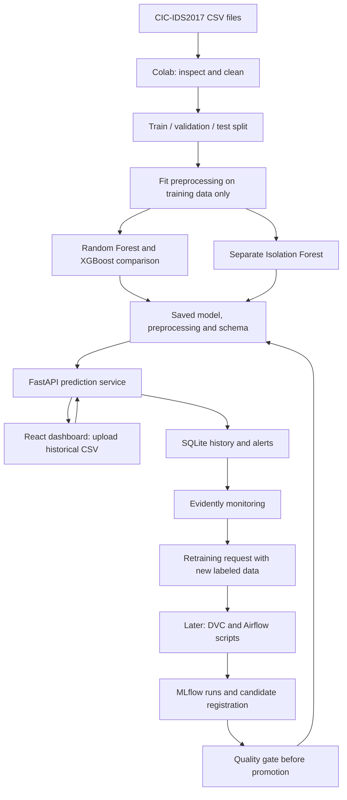

# SENTINEL AI

An educational intrusion detection project for a third-year B.Tech student.
The application classifies recorded network flows and displays predictions in a local dashboard.
It is a dataset-based prototype, not a production network protection system.

## Current progress

**GitHub and CI are configured for [Atul-1972/SENTINEL-AI](https://github.com/Atul-1972/SENTINEL-AI).** The workflow checks backend/API tests, the frontend build and an isolated Docker startup check on pushes and pull requests. See [Actions](https://github.com/Atul-1972/SENTINEL-AI/actions/workflows/ci.yml) for the actual remote result and [docs/phase4_github_ci.md](docs/phase4_github_ci.md) for the guide. Local checks passed: 30 backend tests, 18 frontend tests, production build and artifact-free Docker smoke check. Remote completion is recorded separately after the first run is verified.

**The frontend is complete: five responsive React pages connect to the verified Docker API and persistent SQLite history.**

From the project folder, start the API and then the frontend:

```powershell
docker compose up -d --wait --wait-timeout 120 api
Set-Location .\frontend
npm run dev
```

Open <http://127.0.0.1:5173>. Dependencies are installed; a fresh checkout needs Node >=22.12 and `npm ci` inside `frontend` first. The dashboard includes Overview, CSV Detection, Threats, Performance and Monitoring. See [docs/frontend.md](docs/frontend.md) for the full guide and screenshots.

Frontend-phase validation passed: **18 frontend unit tests, 5 browser tests, 28 backend tests**, and a production build/desktop/mobile preview. The backend suite now has 30 tests after CI preparation. The production dependency audit is clear; an unpatched development-tool dependency advisory is recorded in the guide. External MLOps integrations remain pending; the dashboard does not poll GitHub for live CI status.

**Phase 3 is also complete: the verified FastAPI service runs in a healthy Docker container with persistent SQLite storage.**

Open Docker Swagger at <http://127.0.0.1:8001/docs>. The real image build, model-output HTTP
checks, container restart and new-container persistence checks all passed. The regression suite
now has **28 passing tests**. See [docs/phase3_docker.md](docs/phase3_docker.md) for the full guide
and [reports/phase3_container_verification.json](reports/phase3_container_verification.json) for evidence.

From Windows PowerShell in this project folder:

```powershell
docker compose up -d --wait --wait-timeout 120 api
docker compose ps
docker compose logs --tail 50 api
```

To rebuild after code/model changes, run `docker compose build api` before `up`.
Compose keeps the container's database in the `sentinel-ai_api-data` volume. The original
Windows API below uses a separate database and port. The original Docker check submitted
11 actual historical examples; frontend verification brought the total to 51. These are test submissions, not live events.

Phase 2 is also complete: FastAPI serves the verified models and persists predictions/alerts in SQLite.

The API is running at <http://127.0.0.1:8000/docs>. Expand **POST /predict**, click **Try it out**,
and execute its prefilled historical example. All seven requested endpoints are implemented.
Its initial automated checks passed (**26 tests**), and a real HTTP smoke run verified model outputs,
invalid-batch rejection, persistent history, alerts and statistics.

See [docs/phase2_backend.md](docs/phase2_backend.md) for the input contract, risk-scoring table,
complete Windows PowerShell commands, Swagger demo and validation details.

To start the API again from the project root:

```powershell
.\.venv-model\Scripts\python.exe -m uvicorn backend.main:app --host 127.0.0.1 --port 8000
```

Use the existing server if port 8000 is already occupied by it. Do not start a duplicate process.
The SQLite file is `data/sentinel.db`. The initial verification submitted 11 real historical demo
flows; new requests add history and GET requests do not. No fabricated live events are preloaded.

Phase 1 is also complete: trained artifacts are downloaded and inference is verified locally.
Your shared output confirms 225,745 source records: 97,718 BENIGN and 128,027 DDoS.
The first 10,000-row preview contained only BENIGN records, so we scanned the full Label column.
The corrected notebook handles repeated feature headers without dropping column values.

Your Step 7 output confirms a 20,000-row subset split into 12,000 training, 4,000 validation,
and 4,000 test records, with both classes in each partition.
Step 8 trained Random Forest with training-only preprocessing. Your screenshots confirm a
validation confusion matrix of `[[1704, 1], [5, 2290]]` (BENIGN, ATTACK), 99.85% accuracy,
and a successful saved-artifact reload check. These are validation results within one capture,
not final test results or evidence of performance on other attacks/networks.

Step 9 completed in Colab. XGBoost's validation matrix is `[[1705, 0], [3, 2292]]`:
99.925% accuracy, no false alarms, and three missed attacks. Both saved-model reload checks
passed. The comparison recommended XGBoost before final test evaluation.

Step 10 completed in Colab: the anomaly model and its preprocessing were saved and reload
checks passed. XGBoost remains recommended. The supplied histogram shows overlap between
normal and attack scores; do not present anomaly flags as an attack category or as a replacement
for the supervised classifier. The full anomaly report is now available locally.

Step 11's shared test output confirms accuracy 99.85%, attack precision 100%, attack recall
approximately 99.7386%, and attack F1 approximately 99.8691%. The 4,000-record test set has
no false alarms and six missed attacks. The original fixed quality gate passed. These are
random-holdout results from one capture, not evidence of generalization to other attacks or networks.

The ZIP is extracted into this workspace. All seven required artifacts and the native XGBoost
model are present. Recorded model checksums match the frozen selection. All 10 historical
demo predictions, raw probabilities, anomaly scores and flags reproduce Colab's outputs locally.
No final test predictions were repeated. The complete saved test report gives ROC-AUC
0.999589953935305. See [reports/local_verification.json](reports/local_verification.json).

The local runtime is Python 3.13.15 with the exact five exported package versions;
Colab used Python 3.13.18. XGBoost 3.4.1 requires Python >= 3.12. The native
`artifacts/model.ubj` loads and reproduces the recorded outputs. The classifier's joblib
snapshot raises `XGBoostError: input stream corrupted` in this Windows environment,
so use native XGBoost model IO for the backend. Preprocessing and anomaly joblib files
load correctly. The original files and ZIP are preserved.

The anomaly validation report shows attack recall approximately 15.99%, benign false
positive rate approximately 5.51%, and ROC-AUC approximately 0.74282 at the fixed cutoff.
Keep it supplementary to XGBoost. Do not change the cutoff or model choice using test results.

See [CHECKPOINT.md](CHECKPOINT.md) for the saved progress and resume instructions.

### Verify the local export — Windows PowerShell

```powershell
Set-Location -LiteralPath 'C:\Users\ATUL KUMAR AGRAHARI\OneDrive\Desktop\MSE-2 GENAI'
.\.venv-model\Scripts\python.exe scripts\verify_phase1.py
```

Expected: `status` is `passed`, `demo_flows_verified` is 10, and the classifier/anomaly
output checks are true. The report records the unsupported classifier joblib snapshot
and successful native UBJSON loading. This command predicts historical validation examples
and checks the test-file checksum; it does not evaluate the test set again.

The project-local `.python/` runtime and `.venv-model/` environment are installed. Select
`.venv-model\Scripts\python.exe` if choosing a VS Code interpreter. The older `.venv/`
uses Python 3.11 and was used for synthetic checks; use `.venv-model/` for actual models.

To recreate the model environment when needed, use the installed `uv` tool in PowerShell:

```powershell
$env:UV_PYTHON_INSTALL_DIR = Join-Path (Get-Location) '.python'
uv python install 3.13 --install-dir .python --no-bin --no-registry --no-cache
uv venv --python 3.13 --managed-python --no-python-downloads --no-cache .venv-model
uv pip install --python .venv-model\Scripts\python.exe --no-cache -r requirements-model.txt
```

See [uv's Python installation guide](https://docs.astral.sh/uv/guides/install-python/) and
[XGBoost's model IO guidance](https://xgboost.readthedocs.io/en/stable/tutorials/saving_model.html).
The user authorized Phases 2 and 3, then explicitly requested the frontend ahead of the remaining phases, followed by GitHub/CI. The application and CI configuration are implemented. MLflow, DVC, Airflow, Evidently and retraining remain pending.

To run Step 8 in your existing Colab session, upload
[phase1_random_forest_colab.py](notebooks/phase1_random_forest_colab.py) using its Files panel,
then execute this cell there (not in Windows PowerShell):

```python
%pip install -q "matplotlib>=3.8,<4"
%run /content/phase1_random_forest_colab.py
```

This uses the Step 7 outputs already under `/content/SENTINEL-AI`. If the runtime reset,
recreate or restore those outputs first. The script saves a candidate under
`/content/SENTINEL-AI/artifacts/candidates/random_forest/`, including measured validation
metrics, the fitted model, preprocessing, schema, package versions, and confusion-matrix image.
Only compare candidates using validation data; reserve final test evaluation until after selection.

To reproduce Step 9, upload [phase1_xgboost_colab.py](notebooks/phase1_xgboost_colab.py) into the existing
Colab runtime and execute a new cell:

```python
%pip install -q "xgboost>=2.1,<4"
%run /content/phase1_xgboost_colab.py
```

The script requires the Step 8 candidate artifacts, verifies their validation confusion matrix,
and reuses the saved preprocessor without refitting it. It saves an XGBoost candidate, a native
UBJSON model in addition to joblib, a validation confusion matrix, and model_comparison.csv/json.
See the [XGBoost model IO guide](https://xgboost.readthedocs.io/en/stable/tutorials/saving_model.html)
for why the native model file is useful alongside version-specific Python serialization.

The educational validation targets are recall >= 0.98, attack F1 >= 0.98, and false positive rate
<= 0.01. Among passing candidates, the report prioritizes attack recall, then lower false positive
rate, F1, smaller model size, and lower batch prediction time. These are project choices, not
certified security requirements. Recommendation does not promote or deploy a model.

To reproduce Step 10, upload [phase1_isolation_forest_colab.py](notebooks/phase1_isolation_forest_colab.py)
through Colab's Files panel and run this in a new code cell:

```python
%run /content/phase1_isolation_forest_colab.py
```

It reuses the selected classifier's saved preprocessing and fits Isolation Forest using only
BENIGN training records. The fixed contamination setting is 0.05: it sets the cutoff from the
training reference and is not a claimed validation false-positive rate or live attack probability.
The script reports `-decision_function` as the anomaly score (larger is more unusual; positive
flags an anomaly), saves separate artifacts and validation diagnostics, and leaves test.csv reserved.
See the [Isolation Forest documentation](https://scikit-learn.org/1.6/modules/generated/sklearn.ensemble.IsolationForest.html).
Anomaly flags neither identify DDoS nor replace the supervised classifier's predictions.

Next, upload [phase1_finalize_colab.py](notebooks/phase1_finalize_colab.py) through Colab's
Files panel and run this new code cell:

```python
%run /content/phase1_finalize_colab.py
```

The script freezes the validation-based classifier selection before examining test labels,
evaluates the unchanged classifier against the reserved test split, and checks the same fixed
quality thresholds. It does not train, tune thresholds, or switch classifiers using test results.
Selection and artifact changes after freezing are rejected. If final results already exist for
the same inputs, reruns reuse them instead of predicting the test set again. Preserve the lock
and result files; a failed/interrupted evaluation should be reviewed rather than silently restarted.

After a successful run, download `/content/SENTINEL-AI/sentinel_phase1_bundle.zip` from
Colab's Files panel. The bundle contains:

```text
artifacts/
    model.joblib
    preprocessor.joblib
    anomaly_model.joblib
    feature_schema.json
    model_params.json
    evaluation_metrics.json
    label_mapping.json
    model.ubj                 # when XGBoost is selected
data/processed/               # the 20,000-row train/validation/test splits
data/sample/historical_demo_flows.csv
reports/                     # comparison, test results, plots and inference reload check
requirements-model.txt       # exact model package versions
README.txt
```

Demo flows come from validation records; their predictions and separate anomaly flags are
calculated with the exported models. If the final quality gate fails, the bundle remains available
for review with `eligible_for_api_demo` set to false. Keep the previous model choice and report
the limitation; do not choose a different candidate by looking at test scores.

Move the downloaded ZIP into this project folder. Extract it using **Windows PowerShell**:

```powershell
Set-Location -LiteralPath 'C:\Users\ATUL KUMAR AGRAHARI\OneDrive\Desktop\MSE-2 GENAI'
Expand-Archive -LiteralPath '.\sentinel_phase1_bundle.zip' -DestinationPath '.' -Force
```

Keep the original full CSV separately; it is not bundled. Save/download your current Colab
notebook as well. Share the final test report and confirm the download before moving to Phase 2.

## Practical scope

1. First classify `BENIGN` versus `ATTACK` using Random Forest.
2. Compare XGBoost using validation data, then evaluate the selected model on an untouched test set.
3. Add Isolation Forest as a separate anomaly flag. It does not identify attack categories.
4. Save the model, preprocessing, feature schema, label mapping, package versions, and evaluation results.
5. After Phase 1 is working and you confirm it, build the API, Docker setup, CI, MLOps workflow, and dashboard in the requested order.
6. Add multiclass prediction only for labels actually represented in the training data.

Aim for an initial training subset of roughly **20,000 rows** from one attack-day CSV,
sampled reproducibly while preserving the available class proportions. Increase to 50,000 only
if the smaller run is insufficient. Remove or group duplicate flows before splitting.
The notebook's initial preview is **not** this training subset. Target small training runs of about
5–15 minutes; actual runtime must be measured and depends on the data and runtime.

## Planned technology stack

| Area | Choice | Purpose |
| --- | --- | --- |
| Training | Google Colab, Python, pandas, NumPy, matplotlib | Inspect and prepare data, visualize results |
| Models | scikit-learn Random Forest, XGBoost, Isolation Forest | Classification comparison and separate anomaly detection |
| Artifacts | joblib and JSON | Save fitted objects, schema, and measured results |
| Backend | FastAPI, Pydantic | Validated prediction endpoints and Swagger docs |
| Storage | SQLite, SQLAlchemy | Predictions, alerts, model and monitoring history |
| Frontend | React, Vite, Tailwind CSS, Recharts | Five dashboard views connected to the API |
| Experiments | MLflow | Compare runs and register selected models |
| Reproducibility | Git, DVC with local storage | Version code and data; reproduce pipeline stages |
| Orchestration | Apache Airflow, run in Linux containers | Schedule reusable Python pipeline steps |
| Monitoring | Evidently | Compare reference and recent data distributions |
| Delivery | Docker, GitHub Actions, pytest | Package the API and automate tests and builds |

Install tools when their phase begins. Record exact training package versions and use matching
versions for inference. MLflow and Airflow do not need to run together during every demo on an 8 GB laptop.

## Architecture



The Colab notebook is the first training demonstration. Later, its training logic becomes reusable
scripts for DVC and Airflow; Airflow will not depend on manually running Colab.
Live prediction accuracy can only be measured when reliable true labels become available.

## Phase 1, step 1: obtain a CSV

### Smaller dataset plan

You do not need the full dataset for the first college demonstration. Start with just
`Friday-WorkingHours-Afternoon-DDos.pcap_ISCX.csv`, inspect its labels, and then prepare
a 20,000-row development subset. Use only the classes confirmed in that file; this first
version will not demonstrate every attack type in CIC-IDS2017.

A [community mirror offers this individual file (77.1 MB)](https://huggingface.co/datasets/c01dsnap/CIC-IDS2017/blob/main/Friday-WorkingHours-Afternoon-DDos.pcap_ISCX.csv).
Open the file page and click **Download file**, rather than downloading the whole repository.
Its [dataset card](https://huggingface.co/datasets/c01dsnap/CIC-IDS2017/raw/main/README.md)
and [license text](https://huggingface.co/datasets/c01dsnap/CIC-IDS2017/raw/main/LICENSE)
identify CIC-IDS2017 and reproduce the original research-use/citation notice.
The mirror's schema, labels, and equivalence to the official archive have not been verified here.
Inspect the downloaded CSV with the notebook before preparing training data.

The **77.1 MB download** and the **20,000-row training subset** are different sizes.
Sampling reduces training memory and time after download; it does not reduce that initial download.
Do not take just the first 20,000 rows: time-ordered records can contain mostly one class.
We will preserve class proportions rather than artificially balancing the test set, and reserve
held-out evaluation data before fitting preprocessing or models. Results will apply to this
limited dataset, not to all attacks or real-world network traffic.

### Official archive route, if individual files are unavailable

1. Visit the [official CIC-IDS2017 page](https://www.unb.ca/cic/datasets/ids-2017.html).
2. Read its License section and retain the required paper citation in your report:
   Iman Sharafaldin, Arash Habibi Lashkari, and Ali A. Ghorbani,
   *Toward Generating a New Intrusion Detection Dataset and Intrusion Traffic Characterization*, ICISSP, 2018.
3. Click **Download this dataset** and complete the provider's form yourself if requested.
4. Select **MachineLearningCSV.zip**, then extract it. The official page identifies this as the
   machine-learning CSV archive. You do not need the PCAP packet captures for this project.
5. Start with one attack-day CSV, such as a Friday DDoS file if present. Verify its actual labels
   in the notebook. Monday contains benign traffic only and cannot support binary training by itself.
6. Upload the extracted CSV directly using Colab's left **Files** panel. If it is already
   uploaded there, keep using that file. Preserve an untouched copy on your computer.

The official form displayed a server-error message when checked on 14 November 2026.
If the download fails, report the message. The community mirror above has had its filename,
size, attribution, and license text checked; its actual CSV schema and labels still need inspection.
Do not substitute a different dataset silently.

## Open the notebook in Google Colab

1. Open [Google Colab](https://colab.research.google.com/).
2. Use **File → Upload notebook** (or **Open notebook → Upload**).
3. Select `notebooks/01_model_training.ipynb` from this project.
4. Save a copy in Drive. Use a Python 3 runtime with the hardware accelerator set to **None/CPU**.
   These initial classical models do not require a GPU.
5. Run the first code cell, then the dependency cell. If Colab asks to restart the session, restart
   and rerun from the first cell before continuing.
6. Upload your CSV in Colab's left **Files** panel if needed, then run the data-directory cell.
   It uses `DATA_DIR = Path("/content")` for direct uploads; no Drive mount is required.
7. Run the file-list cell. Set `CSV_PATH` to the exact file you selected, then run the inspection cell.
8. Download `dataset_inspection.json` using Colab's Files panel, or copy the printed output back to the chat.

Colab supports notebook uploads and Drive storage, but runtime files can disappear when a session ends.
Keep the original CSV on your computer, save the notebook, and download the inspection report.
If the runtime resets, upload the CSV again. Saving the notebook does not save the runtime's CSV.
See the [official Colab FAQ](https://research.google.com/colaboratory/faq.html).

### Optional: use an existing Google Drive CSV instead

Replace the notebook's data-directory cell with this code, then run the following file-list cell:

```python
from pathlib import Path
from google.colab import drive

drive.mount("/content/drive")
DATA_DIR = Path("/content/drive/MyDrive/SENTINEL-AI/data/raw")
print("Data directory:", DATA_DIR)
```

The file-list cell looks directly inside `DATA_DIR`. Point it at the folder containing the CSV.

### First executable cell — run in Colab

```python
import sys
from pathlib import Path

print("SENTINEL AI — Phase 1")
print("Python:", sys.version.split()[0])
print("Working directory:", Path.cwd())
print("Setup cell completed. No model has been trained.")
```

Expected form of output; the version and directory depend on your runtime:

```text
SENTINEL AI — Phase 1
Python: <your runtime version>
Working directory: <your runtime directory>
Setup cell completed. No model has been trained.
```

### Optional — open local instructions from Windows PowerShell

```powershell
Set-Location -LiteralPath 'C:\Users\ATUL KUMAR AGRAHARI\OneDrive\Desktop\MSE-2 GENAI'
Get-Content -LiteralPath '.\README.md'
```

No local Python environment or training command is required at this step.

## What to send back before the next step

Send the selected CSV filename, preview shape, column list, label counts, and any error.
The notebook prints these and saves them in `dataset_inspection.json`.
Its counts cover at most the first 10,000 rows, not the full file. A prefix can miss attacks
because records may be ordered by time. Do not use that preview as a representative training sample.

Next we will inspect full-file label counts with bounded memory, handle missing/infinite values and
duplicates, choose safe numeric features, and prepare train/validation/test partitions.
Identifiers, timestamps, and labels will not be blindly used as features.
We will examine whether a source-aware or time-based holdout is feasible; random splits alone can
overestimate performance on related network flows.
All fitted preprocessing and feature selection will learn from the training partition only.

**Phase 1 is complete only when saved preprocessing and a saved model successfully predict held-out records.**
This starter does not meet that milestone yet. Do not proceed to Phase 2 until Phase 1 works and you confirm it.
